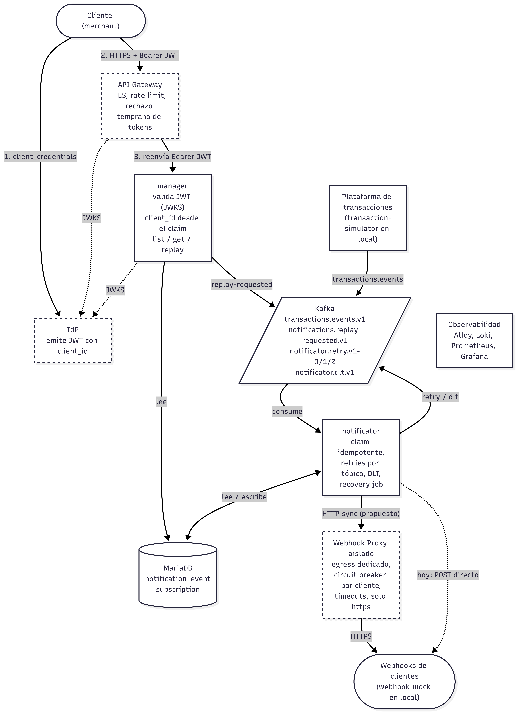

# cobre-notificator

Sistema de notificaciones por webhook. Consume los eventos de transacciones de la plataforma y los entrega al webhook que cada cliente tiene suscripto. Cada entrega tiene reintentos, circuit breaker por cliente y recuperación ante fallas. Además ofrece una API self-service para que el cliente consulte sus notificaciones y pida un replay de las que fallaron.

Este README separa dos cosas:

- **Implementado**: lo que corre con `docker compose up`. Es el alcance del examen.
- **Diseño propuesto**: lo que haría con más tiempo o en un entorno real. No está en el código.

## Alcance

| Componente | Estado | Qué hace |
|---|---|---|
| notificator | Implementado | entrega de eventos, reintentos por tópico, DLT, replay, circuit breaker por cliente, job de recuperación |
| manager | Implementado | API self-service: listado paginado, detalle y replay. Identifica al cliente con `X-Client-Id` (solo desarrollo, ver [IdP + JWT](#idp--jwt)) |
| Kafka, MariaDB | Implementado | nodo único, sin TLS ni autenticación |
| Observabilidad | Implementado | métricas, logs, dashboards y alertas |
| transaction-simulator, webhook-mock | Implementado, solo local | reemplazan a la plataforma y a los webhooks de los clientes |
| IdP | Propuesto | emite JWT con el `client_id` del cliente |
| API Gateway | Propuesto | punto de entrada de los clientes: TLS, rate limit, rechazo temprano de tokens |
| Webhook egress proxy | Propuesto | única salida hacia los webhooks, con circuit breaker propio |
| Backoffice de suscripciones | Propuesto | alta y edición de suscripciones; hoy vienen de un seed SQL |

## Arquitectura



Los bordes punteados son componentes propuestos. Flujo:

1. La plataforma publica cada transacción en `transactions.events.v1`, con `event_id` como key.
2. El notificator la consume, la registra en MariaDB y hace POST al webhook de la suscripción activa. Si falla, la reintenta por tópicos de retry y, agotados los intentos, la marca `FAILED`.
3. El cliente consulta sus notificaciones en el manager y pide replay de las `FAILED`. El manager publica el pedido en `notifications.replay-requested.v1` y el notificator lo procesa con el mismo flujo de entrega.

En el diseño propuesto el cliente entra por el gateway con un JWT emitido por el IdP, y el notificator no llama al webhook directamente: hace un POST síncrono al egress proxy.

## Stack

### Implementado

| Categoría | Tecnología |
|---|---|
| Lenguaje | Java 25 (virtual threads en el simulador) |
| Framework | Spring Boot 4.1.1: Web MVC, JDBC (`JdbcClient`), Spring Kafka (`@RetryableTopic`), Actuator |
| Resiliencia | Resilience4j 2.4.0 (circuit breaker por cliente) |
| Mensajería | Apache Kafka 4.1.0 en modo KRaft; Kafka UI (kafbat) |
| Base de datos | MariaDB 12.3; schema, usuarios por aplicación y seeds en [notificator/db/](notificator/db/) |
| Observabilidad | Micrometer, Prometheus 3.5, Grafana Alloy 1.10, Loki 3.5, Grafana 12.1 |
| Build y ejecución | Maven, Docker multi-stage (Eclipse Temurin 25), Docker Compose |
| Calidad | JUnit 5, Mockito, Spring Boot Test; google-java-format (fmt-maven-plugin 2.29) |
| Specs y diagramas | OpenSpec ([openspec/specs/](openspec/specs/)), Mermaid ([docs/](docs/)) |
| Pruebas manuales | Colecciones de Postman ([manager](pruebas/manager.postman_collection.json), [webhook-mock](pruebas/webhook-mock.postman_collection.json)), curl |

### Propuesto

| Categoría | Tecnología |
|---|---|
| Identidad | IdP OAuth2/OIDC (Keycloak o un servicio gestionado); el manager valida el JWT como resource server de Spring Security |
| Borde | API Gateway |
| Egress | Servicio proxy de webhooks con IP de salida fija |
| Infraestructura | Kafka con SASL/TLS, ACLs y replication factor 3; secret manager |

## Cómo correrlo

Requisitos: Docker con Compose y al menos 8 GB de RAM: `manager` y `notificator` arrancan con el heap fijo en 2 GB cada uno (`-Xms2g -Xmx2g` en su `Dockerfile`). Maven y Java 25 solo para correr los tests fuera de Docker.

```sh
cp .env.example .env          # cambiar las contraseñas
docker compose up -d --build
```

| Servicio | URL |
|---|---|
| manager (API) | `http://localhost:9290` |
| webhook-mock | `http://localhost:8090` |
| Kafka UI | `http://localhost:8080` |
| Grafana | `http://localhost:3000` (usuario `admin`, contraseña `GRAFANA_ADMIN_PASSWORD`) |
| Prometheus | `http://localhost:9090` |
| Kafka desde el host | `localhost:9094` |

Todo se publica solo en `127.0.0.1`, salvo el manager (`9290`) y MariaDB (`3306`). Para empezar de cero: `docker compose down -v` (borra todos los datos locales).

### Cómo evaluarlo en 5 minutos

Las colecciones de Postman y el script para suscribir un webhook real están en [pruebas/](pruebas/README.md).

1. Levantar el simulador: `docker compose --profile simulator up -d transaction-simulator` (3000 eventos/min).
2. Abrir Grafana, dashboard **General**: entregas por minuto, tasa de éxito y latencias.
3. Hacer fallar a un cliente: `curl -X PUT localhost:8090/config/clients/CLIENT002 -H 'Content-Type: application/json' -d '{"status":503,"delay_ms":0}'`. En el dashboard **Cliente** (`client=CLIENT002`) el circuito se abre en segundos y los eventos pasan a `RETRYING`. Los demás clientes siguen entregando.
4. Importar la colección [manager.postman_collection.json](pruebas/manager.postman_collection.json) y correr *Listado → Listar FAILED* y después *Replay → Replay (202)*. *Detalle → Obtener por id* muestra el evento reabierto.
5. Volver CLIENT002 a 200: `curl -X DELETE localhost:8090/config/clients/CLIENT002`.

### Tests

```sh
cd notificator && mvn verify     # tests unitarios + chequeo de formato
cd manager && mvn verify
mvn com.spotify.fmt:fmt-maven-plugin:format   # aplica el formato
```

Los tests no necesitan Kafka ni MariaDB.

## Implementado

### Kafka

Broker de un nodo en modo KRaft (`apache/kafka:4.1.0`), definido en `docker-compose.yml`. La auto-creación de tópicos está deshabilitada: los tópicos los crea el servicio one-shot `kafka-init` con [kafka/create-topics.sh](kafka/create-topics.sh), que es idempotente.

| Tópico | Rol | Particiones | Retención |
|---|---|---|---|
| `transactions.events.v1` | principal, inicio del flujo | 10 | 7 días |
| `notificator.retry.v1-0` | reintento 1 (60 s) | 3 | 1 día |
| `notificator.retry.v1-1` | reintento 2 (300 s) | 3 | 1 día |
| `notificator.retry.v1-2` | reintento 3 (1500 s) | 3 | 1 día |
| `notificator.dlt.v1` | reintentos agotados | 3 | 14 días |
| `notifications.replay-requested.v1` | replays pedidos desde el manager | 3 | 7 días |

Key de los mensajes: `event_id`, en `transactions.events.v1` y en `notifications.replay-requested.v1`. Retry y DLT conservan la key del mensaje de origen. La key por evento reparte la carga aunque el tráfico por cliente sea muy desigual; no hay orden garantizado entre eventos de un mismo cliente (los reintentos ya lo rompen) y la idempotencia la da `UNIQUE (client_id, event_id)` en la base.

El principal tiene 10 particiones porque lleva todo el tráfico; retry, DLT y replay tienen 3. El notificator consume el principal con 10 threads por pod (`KAFKA_LISTENER_CONCURRENCY`) y retry y DLT con 3. Con varios pods, `pods × KAFKA_LISTENER_CONCURRENCY` tiene que cubrir las 10 particiones; los threads de más quedan ociosos.

Conexión:
- Desde los contenedores: `kafka:9092`.
- Desde el host: `localhost:9094`, publicado solo en `127.0.0.1`.
- UI: [Kafka UI](https://github.com/kafbat/kafka-ui) en `http://localhost:8080` (`KAFKA_UI_PORT` para cambiarlo), solo en `127.0.0.1` y sin auth.

El script nunca cambia las particiones de un tópico existente. Para empezar de cero, usar `docker compose down -v`.

### Notificator

Consume `transactions.events.v1` y entrega cada evento al webhook de la suscripción activa de su `client_id` y `event_type`.

Diagramas del flujo, uno por caso:

1. [Entrada: qué tópico, qué caso](<docs/1 - Entrada qué tópico, qué caso es.png>)
2. [Primer intento](<docs/2. Primer intento.png>)
3. [Entrega (compartida por primer intento, reintento y replay)](<docs/3. Entrega (compartida por primer intento, reintento y replay).png>)
4. [Reintento y agotamiento](<docs/4. Reintento y agotamiento.png>)
5. [Replay](<docs/5. Replay.png>)
6. [Recuperación de filas trabadas](<docs/6. Recuperación de filas trabadas.png>)
7. [Errores de infraestructura (transversal)](<docs/7. Errores de infraestructura (transversal).png>)

**Estados** de `notification_event`:
- `PENDING`: primer intento en curso.
- `RETRYING`: el último intento falló con un error reintentable (timeout, conexión, 408, 429, 5xx) o lo rechazó el circuit breaker del cliente (`last_error = "Circuit open"`).
- `DELIVERED`: el webhook respondió 2xx.
- `FAILED`: código no reintentable, URL no `https`, o se agotaron los 4 intentos (reintentos a los 60 s, 300 s y 1500 s).
- `NOT_SUBSCRIBED`: no hay suscripción activa.

**`attempts`** cuenta los intentos iniciados de la generación actual y no baja dentro de ella. Cada intento lo reclama en la DB antes del POST:
- el primero, con un `INSERT` sobre `(client_id, event_id)`;
- los siguientes, con un `UPDATE ... WHERE generation = g AND attempts = n - 1`.

**Identidad**: cada notificación tiene un `notification_event_id` propio, un UUIDv7 que genera la base (`id`, PK de `notification_event`) y que no cambia en reintentos ni replays. El `event_id` es el del productor y solo es único por cliente: `UNIQUE (client_id, event_id)` es la clave de idempotencia, así que el mismo `event_id` de dos clientes son dos notificaciones distintas. La API del manager usa `notification_event_id` en el path (`GET /notification_events/{notification_event_id}`, `POST .../replay`). Las respuestas y el cuerpo del webhook incluyen los dos ids, y el POST lleva los headers `X-Notification-Event-Id` y `X-Event-Id`.

**Replay**: el notificator consume `notifications.replay-requested.v1` y reabre un evento `FAILED` con un único `UPDATE`: `generation = generation + 1`, `attempts = 1`, `PENDING`, solo si el `client_id` y la `generation` del pedido coinciden con la fila. Un pedido duplicado u obsoleto pierde ese claim y se descarta. El replay usa los mismos tópicos de retry y DLT; todo `UPDATE` exige la `generation` del mensaje, así que un retry viejo nunca toca la generación nueva.

**Circuit breaker por cliente**: cada `client_id` tiene su propio breaker (Resilience4j, en memoria de cada instancia) sobre el POST. Cada POST es síncrono y ocupa el hilo de una partición que comparten varios clientes; el breaker evita que un cliente caído o lento frene a los demás. Abren el circuito solo las señales de cliente no disponible: timeout, error de conexión, 429, 502, 503 y 504. Un 500 o un 408 se reintentan pero no lo abren. El circuito abre cuando, en los últimos 60 s, el cliente hizo al menos 10 llamadas y más de la mitad fallaron; una ventana por tiempo trata igual a un cliente de alto y de bajo volumen. Con el circuito abierto no se hace POST: el intento cuenta y el evento sigue los reintentos normales (un cliente caído más de ~31 min termina en `FAILED` y se recupera con replay). A los `CIRCUIT_OPEN_WAIT` (30 s, menor que el primer reintento) el circuito pasa a semiabierto y deja pasar 2 llamadas de prueba, que lo cierran o lo vuelven a abrir. Cada cambio de estado se loguea como INFO (`Circuit state changed`).

**Perfiles de circuito**: un cliente con pocas llamadas por minuto nunca llega a 10 en 60 s, así que con el default su circuito no abre. Para esos casos `application.yml` define perfiles que heredan del default y solo cambian la ventana y el mínimo; el de ejemplo es `bajo-volumen` (300 s, mínimo 5). El perfil de un cliente se asigna en su entorno con `resilience4j.circuitbreaker.instances.<client_id>.base-config`. En `docker-compose.yml` va por `SPRING_APPLICATION_JSON`, que asigna `bajo-volumen` a `CLIENT008`: con una variable de entorno común Spring pasaría la clave a minúsculas y el nombre no coincidiría con el `client_id`. Un `client_id` mal escrito no da error: crea un breaker que nunca se usa y aparece con ese nombre en `resilience4j_circuitbreaker_state`. Los cambios se toman al reiniciar el notificator.

Un evento duplicado o un mensaje de retry viejo pierde ese claim y se descarta sin POST. Si la DB no responde, el mensaje se reintenta en el mismo offset y no pasa a los tópicos de retry. Un job reanuda cada 60 s los eventos que quedaron en `PENDING` o `RETRYING` sin avanzar (crash, rebalance).

**Entrega at-least-once**: un crash entre el 2xx y la escritura puede repetir el POST. Cada POST lleva `X-Event-Id` para que el cliente deduplique y `X-Delivery-Attempt` con el número de intento.

**Métricas** en `/actuator/prometheus` (puerto 9391):

| Métrica | Tags |
|---|---|
| `notificator_deliveries_total` | `outcome` (delivered, retrying, failed, not_subscribed), `client_id`. `failed` incluye los eventos que cierra el job de recuperación |
| `notificator_webhook_attempts_total` | `client_id`, `attempt` (1..4), `status` (código HTTP, `timeout`, `connect_error`, `io_error`, `circuit_open`), `outcome` (delivered, retryable, permanent) |
| `notificator_webhook_latency_seconds` | `client_id`, `outcome`; buckets fijos de 5 ms a 10 s; solo llamadas hechas (no `circuit_open`) |
| `resilience4j_circuitbreaker_state` | `name` (el `client_id`), `state` (closed, open, half_open, ...); 1 en el estado actual |
| `notificator_delivery_e2e_seconds` | sin tags; de `created_at` a `DELIVERED`, solo la generación 0 (no replays); buckets de 100 ms a 2 h |
| `notificator_discarded_total` | `reason` (duplicate, stale, dlt_ignored) |
| `notificator_replays_total` | `outcome` (started, discarded) |
| `notificator_dlt_messages_total` | `reason` (exhausted, invalid, unexpected) |
| `notificator_recovery_events_total` | `action` (republished, failed) |
| `notificator_persistence_errors_total` | `exception` (tipo del error transitorio de la base, reintentado en el mismo offset) |

Los contadores con tags de valores fijos (`discarded`, `replays`, `dlt_messages`, `recovery_events`) existen en 0 desde el arranque, para que `increase()` no pierda el primer evento.

En local el webhook admite `http` (`WEBHOOK_ALLOW_HTTP=true` en `docker-compose.yml`); en producción solo `https`.

### Manager

API self-service en el puerto `9290`. Cada request queda acotado al cliente que lo hace.

| Método | Ruta | Respuesta |
|---|---|---|
| `GET` | `/notification_events` | listado paginado, filtrable por `from`, `to` y `delivery_status` |
| `GET` | `/notification_events/{notification_event_id}` | detalle; `404` si no existe o es de otro cliente |
| `POST` | `/notification_events/{notification_event_id}/replay` | `202` si se publicó el pedido o ya hay un replay en curso; `409` si el evento no está `FAILED`; `503` si Kafka no está disponible |

**Identificación del cliente (solo desarrollo)**: el cliente se identifica con el header `X-Client-Id`; sin él, `401`. Es un atajo para poder probar sin IdP: en el diseño propuesto el `client_id` sale del JWT (ver [IdP + JWT](#idp--jwt)).

Los errores responden `application/problem+json`. La colección [manager.postman_collection.json](pruebas/manager.postman_collection.json) cubre todas las rutas y los errores; las requests de listado guardan el primer `notification_event_id` y el `next_cursor` en variables, así que detalle, replay y página siguiente se corren sin copiar ids.

#### Listado paginado

`GET /notification_events` responde `{ "data": [...], "next_cursor": "..." }`, del más reciente al más antiguo. `size` va de 1 a 100 (por defecto 20; `QUERY_DEFAULT_PAGE_SIZE` / `QUERY_MAX_PAGE_SIZE`). Para pedir la página siguiente se repite el request con `cursor=<next_cursor>` y **los mismos** `from`, `to` y `delivery_status`; `size` puede cambiar. En la última página `next_cursor` es `null`. Un cursor mal formado, de otro cliente o con otros filtros responde `400`.

```sh
curl -s 'localhost:9290/notification_events?delivery_status=DELIVERED&size=2' -H 'X-Client-Id: CLIENT001' | jq
CURSOR=$(curl -s 'localhost:9290/notification_events?delivery_status=DELIVERED&size=2' -H 'X-Client-Id: CLIENT001' | jq -r '.next_cursor // empty')
curl -s "localhost:9290/notification_events?delivery_status=DELIVERED&size=2&cursor=$CURSOR" -H 'X-Client-Id: CLIENT001' | jq
```

### Simulador de transacciones

`transaction-simulator` reemplaza a la plataforma en local: publica eventos aleatorios en `transactions.events.v1` para `CLIENT001`..`CLIENT008` (key = `event_id`), un virtual thread por cliente. No arranca con `docker compose up`; se habilita con el profile `simulator`.

```sh
# 3000 eventos/min (por defecto)
docker compose --profile simulator up -d transaction-simulator

# Otra tasa total
SIMULATOR_EVENTS_PER_MINUTE=600 docker compose --profile simulator up -d transaction-simulator

docker compose --profile simulator stop transaction-simulator
```

El simulador no crea suscripciones. Las de `CLIENT001`..`CLIENT008` vienen del seed `notificator/db/04-seed-subscriptions.sql` y apuntan al [mock de webhooks](#mock-de-webhooks); cualquier otro `client_id` queda en `NOT_SUBSCRIBED`.

### Mock de webhooks

`webhook-mock` (puerto `8090`, solo en `127.0.0.1`) recibe `POST /webhooks/{client_id}` y responde el código y la demora configurados para ese cliente. Arranca respondiendo `200` sin demora. La configuración vive en memoria (se pierde al reiniciar) y la API `/config` no tiene autenticación: es exclusivamente local.

Las suscripciones del seed se crean solo con un volumen de MariaDB nuevo; si la base ya existía, `docker compose down -v` (borra todos los datos locales) y volver a levantar.

```sh
# Ver configuración (defecto + overrides por cliente)
curl localhost:8090/config

# Defecto para todos los clientes sin override: 500 tras 50 ms
curl -X PUT localhost:8090/config -H 'Content-Type: application/json' -d '{"status":500,"delay_ms":50}'

# Solo CLIENT002 responde 503 (reintentos y circuit breaker de ese cliente)
curl -X PUT localhost:8090/config/clients/CLIENT002 -H 'Content-Type: application/json' -d '{"status":503,"delay_ms":0}'

# CLIENT003 tarda 1 s: supera WEBHOOK_READ_TIMEOUT (500 ms) y el notificator corta por timeout
curl -X PUT localhost:8090/config/clients/CLIENT003 -H 'Content-Type: application/json' -d '{"status":200,"delay_ms":1000}'

# Volver CLIENT002 al defecto
curl -X DELETE localhost:8090/config/clients/CLIENT002
```

Para ver el circuit breaker, con el simulador corriendo: poner `CLIENT002` en `503` y, en el dashboard **Cliente** con `client=CLIENT002`, el panel "Estado del circuito" pasa a Abierto en segundos; los intentos rechazados aparecen como `circuit_open` en "Intentos fallidos por código". Cada `CIRCUIT_OPEN_WAIT` (30 s en `docker-compose.yml`) hace una prueba y, mientras siga en 503, vuelve a Abierto; el panel "Circuito en el rango" muestra el tiempo abierto, las aperturas y las pruebas (el semiabierto dura milisegundos y no se ve en el timeline). Con el `DELETE` la siguiente prueba lo cierra. Mientras tanto, los demás clientes entregan sin demora.

`status` va de 200 a 599 y `delay_ms` de 0 a 60000; fuera de rango responde `400`. Si llega un evento cuyo `client_id` no coincide con el del path, el mock lo registra como ERROR (`Cross-client delivery`).

### Observabilidad

`docker compose up` levanta también Prometheus, Loki, Alloy y Grafana. La configuración está en [observability/](observability/).

| Servicio | URL | Rol |
|---|---|---|
| Grafana | `http://localhost:3000` (`GRAFANA_PORT` para cambiarlo) | dashboards (abajo), usuario `admin`, contraseña `GRAFANA_ADMIN_PASSWORD` del `.env` |
| Prometheus | `http://localhost:9090` | scrapea `/actuator/prometheus` de `manager:9291` y `notificator:9391`, y las métricas de Kafka de Alloy (`app=kafka`), cada 15 s |
| Loki | solo red interna | logs de las apps |
| Alloy | solo red interna | lee los logs de los contenedores y los manda a Loki; publica el lag de los consumer groups y los offsets de los tópicos, leídos del broker |

**Dashboards** (tag `cobre`):

- **General**: alertas activas, tasa de éxito, entregas por minuto, mensajes al DLT en la última hora, p95 del webhook y de punta a punta, lag del notificator y eventos recuperados por el job. La fila colapsada "Plataforma" tiene los targets, los replays del manager y los requests HTTP por status.
- **Notificator**: intentos por resultado, intentos por número de intento, estados finales, tasa de `NOT_SUBSCRIBED`, escrituras con 0 filas y errores de persistencia contra errores del webhook.
- **Cliente**: lo mismo filtrado por la variable `client`: tasa de éxito, volumen, fallos por código (HTTP, `timeout`, `connect_error`, `io_error`), latencia del webhook, respuestas por código HTTP (2xx incluidos), estado del circuit breaker con tiempo abierto, aperturas y pruebas (`circuit_open` entre los fallos) y los logs de los intentos fallidos con su `event_id`.
- **Kafka**: lag por consumer group y partición, mensajes por minuto en los tópicos de retry y el DLT, y rebalanceos por grupo.
- **JVM**: por app (variable `app`: `manager` o `notificator`): uptime, versión, CPU, heap después del GC, heap por pool contra el máximo de 2 GB, non-heap, buffers, pausas y overhead de GC, asignación, threads por estado, clases, archivos abiertos, el pool de conexiones a la base (Hikari) y los executors. Los paneles de pausas de GC aparecen con el primer GC después de arrancar.
- **Logs**: los logs de las apps, una línea por evento.

Para ver fallos en **Cliente**, se configura el mock con el simulador corriendo y se elige el cliente en el selector:

```bash
curl -X PUT localhost:8090/config/clients/CLIENT002 -H 'Content-Type: application/json' -d '{"status":503,"delay_ms":0}'      # 503
curl -X PUT localhost:8090/config/clients/CLIENT003 -H 'Content-Type: application/json' -d '{"status":200,"delay_ms":1000}'   # timeout
curl -X PUT localhost:8090/config/clients/CLIENT004 -H 'Content-Type: application/json' -d '{"status":404,"delay_ms":0}'      # 404
curl -X DELETE localhost:8090/config/clients/CLIENT002   # vuelve a 200
```

Grafana y Prometheus escuchan solo en `127.0.0.1`.

**Kafka**: el exporter embebido de Alloy (`prometheus.exporter.kafka`) consulta al broker, así que el lag sigue creciendo aunque el notificator esté caído. Alloy lo publica como `kafka_consumergroup_uncommitted_offsets`, no como `kafka_consumergroup_lag`. Cada tópico de retry y el DLT tienen su propio consumer group (`notificator-retry-0`..`2`, `notificator-dlt`). El lag de los grupos de retry incluye mensajes que esperan su backoff a propósito.

```promql
sum by (partition) (kafka_consumergroup_uncommitted_offsets{consumergroup="notificator", topic="transactions.events.v1"})
```

**Alertas**: reglas del alerting de Grafana en [rules.yml](observability/grafana/provisioning/alerting/rules.yml), en la carpeta `Cobre`. No hay contact point: se ven en *Alerting → Alert rules* y en el panel "Alertas activas" de **General**. La severidad separa las fallas nuestras (`critical`, `warning`) de las del webhook de un cliente (`info`).

| Alerta | Severidad | Se dispara cuando |
|---|---|---|
| App caída | critical | Prometheus no scrapea `manager`, `notificator` o Kafka (Alloy) durante 1 min |
| Notificator sin consumir | critical | el lag del grupo `notificator` supera 10000 y sigue creciendo durante 5 min |
| Errores de persistencia | critical | el notificator no puede escribir en la base durante 2 min |
| DLT por error interno | critical | llega al DLT un mensaje `invalid` o `unexpected` (no `exhausted`) en 10 min |
| Replay sin Kafka | critical | el manager responde un replay con 503 en 5 min |
| Errores del manager | warning | más del 5% de los requests al manager son 5xx (sin el 503 del replay) durante 5 min |
| Muchos clientes fallando | warning | más del 30% de los clientes activos tiene la mayoría de sus intentos sin entregar durante 5 min |
| Recovery cierra eventos | warning | el job de recuperación cierra un evento como `FAILED` en 15 min |
| Circuito abierto | info | el circuito de un cliente lleva 5 min abierto o semiabierto (una alerta por `client_id`) |

Sin tráfico ninguna alerta se dispara. Para verlas en local (con el simulador corriendo):

```bash
docker compose stop notificator    # App caída en ~1 min; Notificator sin consumir en ~9 min a 3000 eventos/min
docker compose stop mariadb        # Errores de persistencia en ~4 min
echo 'not-json' | docker compose exec -T kafka /opt/kafka/bin/kafka-console-producer.sh \
  --bootstrap-server kafka:9092 --topic transactions.events.v1    # DLT por error interno
docker compose stop kafka          # y un POST .../replay de un evento FAILED: 503 y Replay sin Kafka
curl -X PUT localhost:8090/config/clients/CLIENT002 -H 'Content-Type: application/json' \
  -d '{"status":503,"delay_ms":0}'  # Circuito abierto de CLIENT002 en ~6 min
curl -X PUT localhost:8090/config -H 'Content-Type: application/json' \
  -d '{"status":400,"delay_ms":0}'  # Muchos clientes fallando en ~10 min
```

Después, `docker compose start <servicio>` o el `DELETE`/`PUT` del mock que vuelve a `200`; cada alerta vuelve a normal sola.

**Logs**: llegan a Loki con los labels `app` y `level`. `notification_event_id`, `event_id` y `client_id` son campos del JSON, no labels. `notification_event_id` está en los logs de entrega, fallo y replay:

```logql
{app="notificator"} | json | client_id="CLIENT001"
{app=~"manager|notificator", level="ERROR"} | json | event_id="EVT001"
{app=~"manager|notificator"} | json | notification_event_id="01a1311c-4907-792c-a433-4e7984227e77"
```

Las apps escriben JSON; para leerlos se formatean como una línea por evento, con la excepción en la misma línea (`exception=...`, saltos de línea escapados). El dashboard **Logs** ya los muestra así. En la terminal (requiere `jq`):

```bash
docker compose logs -f --no-log-prefix notificator | jq -Rr -f observability/logs.jq
```

`--no-log-prefix` es necesario: el prefijo `servicio |` de compose rompe el JSON.

Los dashboards, los datasources y las alertas se provisionan desde el repo; los cambios hechos en la UI no se guardan.

Alloy monta `/var/run/docker.sock` (equivale a root en el host); es solo para local. En producción los logs los recolecta el agente de la plataforma.

## Diseño propuesto (no implementado)

Lo que sigue no está en el código. Es lo que haría con más tiempo o antes de ir a producción.

### IdP + JWT

**Problema.** Hoy el manager toma el cliente del header `X-Client-Id`, que cualquiera puede mandar. Sirve para desarrollo, pero no autentica a nadie.

**Cómo funcionaría.** El cliente obtiene un JWT del IdP con OAuth2 `client_credentials`. El token lleva el `client_id` en un claim. El manager lo valida como resource server (firma contra el JWKS del IdP, `iss`, `aud`, `exp`) y toma el cliente del claim. El header deja de existir, o queda solo en un perfil de desarrollo que nunca se activa en producción.

**Impacto.** Hay que cambiar la identificación del manager y el spec [client-identification](openspec/specs/client-identification/spec.md). Los casos de uso no cambian: ya reciben el `client_id` como parámetro.

### API Gateway

**Problema.** Los clientes no deberían llegar directo a los servicios internos.

**Cómo funcionaría.** El gateway es el único punto de entrada. Termina TLS, aplica rate limit por cliente y rechaza tokens inválidos antes de que lleguen al manager. Reenvía el JWT sin modificarlo: la validación que vale es la del manager, así que alguien que llegue al manager sin pasar por el gateway tampoco puede hacerse pasar por otro cliente.

**Impacto.** Ninguno en el código actual. El puerto del manager deja de publicarse.

### Webhook egress proxy

**Problema.** Hoy el notificator hace el POST al webhook desde la red interna. Una URL mal intencionada puede apuntar a servicios internos (SSRF), y la lógica de HTTP saliente queda mezclada con la de entrega.

**Cómo funcionaría.** Es un servicio aislado y la única salida hacia los webhooks. Corre en una red sin acceso a los servicios internos, sale con una IP fija que los clientes pueden poner en su allowlist, y tiene el circuit breaker por cliente, los timeouts y las reglas de URL (solo `https`, sin redirecciones, sin IPs privadas). Podría firmar el payload con HMAC por cliente.

**Impacto.** El notificator reemplaza el POST directo por un POST síncrono al proxy. Los reintentos no cambian: el proxy devuelve el código del webhook, y con el circuito abierto devuelve 503, que el notificator ya trata como reintentable. El breaker se mueve al proxy, para no tener dos breakers en serie. El timeout del proxy hacia el webhook tiene que ser menor que el del notificator hacia el proxy. Si no, el notificator corta antes y reintenta un envío que quizás llegó.

### Backoffice de suscripciones

**Problema.** Las suscripciones salen del seed [04-seed-subscriptions.sql](notificator/db/04-seed-subscriptions.sql). No hay forma de crearlas ni cambiarlas.

**Cómo funcionaría.** Una API y una UI para dar de alta, editar y desactivar suscripciones (`client_id`, `event_type`, URL). Valida la URL al guardarla con las mismas reglas que el proxy.

**Para definir.** Quién la usa: el cliente (self-service, detrás del gateway) u operaciones internas. Cómo afecta un cambio a los eventos en curso: hoy cada intento lee la suscripción vigente, así que un reintento ya va a la URL nueva.

### Producción

- **Kafka**: SASL/TLS y ACLs por aplicación (el notificator consume el principal y los internos y produce en los internos; el manager solo produce en `notifications.replay-requested.v1`). Replication factor 3 con `min.insync.replicas=2`.
- **MariaDB**: réplica o servicio gestionado, backups, y MariaDB sin puerto publicado.
- **Secretos**: credenciales desde un secret manager, no desde `.env`.
- **Webhooks**: solo `https` (`WEBHOOK_ALLOW_HTTP` apagado).
- **Logs**: los recolecta el agente de la plataforma. Alloy con el socket de Docker es solo para local.
- **Alertas**: contact points (on-call, chat), que hoy no hay.

## Seguridad (Task 3)

La API pública es la del manager. Tres vulnerabilidades del [OWASP Top 10:2025](https://owasp.org/Top10/2025/) que la afectan, con su equivalente en el [OWASP API Security Top 10:2023](https://owasp.org/API-Security/editions/2023/en/0x11-t10/):

### A01 Broken Access Control (API1: Broken Object Level Authorization)

**Riesgo.** Los ids de las notificaciones viajan en la URL (`/notification_events/{notification_event_id}`). Un cliente autenticado podría cambiar el id y leer o pedir el replay de las notificaciones de otro cliente.

**Implementado.**
- Todas las consultas filtran por el `client_id` del request, que sale de la identificación del cliente y nunca de un parámetro: `WHERE id = :id AND client_id = :clientId`.
- El id de otro cliente responde `404`, igual que uno inexistente, así que la API no revela si un id existe.
- El replay exige el `client_id` en el `UPDATE` que reabre el evento, tanto en el manager como en el notificator.
- Un cursor de paginación de otro cliente o con otros filtros responde `400`.
- Los ids son UUIDv7 generados por la base. Tienen 74 bits aleatorios, así que no se pueden enumerar como un id secuencial.
- Para probarlo: *Errores → Evento de otro cliente (404)* en la [colección de Postman](pruebas/manager.postman_collection.json).

**Propuesto.** Nada adicional en el manager. Este control vale lo que vale la identidad del cliente, que es A07.

### A07 Authentication Failures (API2: Broken Authentication)

**Riesgo.** En una API pública, una autenticación débil (credenciales de larga duración, tokens sin validar, sin límite de intentos) permite que alguien se haga pasar por un cliente, vea sus notificaciones y pida replays en su nombre. Además anula el control de A01.

**Implementado.** La autenticación con IdP y JWT no se llegó a implementar por los tiempos del ejercicio. En su lugar, el manager identifica al cliente con el header `X-Client-Id`:
- Un request sin `X-Client-Id`, vacío o con solo espacios responde `401` antes de cualquier otro procesamiento, incluso en rutas inexistentes.
- Toda ruta nueva queda protegida por defecto.
- Actuator corre en un puerto aparte, no publicado, que no pasa por la identificación.

**Propuesto** (ver [IdP + JWT](#idp--jwt) y [API Gateway](#api-gateway)).
- El cliente obtiene un JWT de corta duración del IdP con OAuth2 `client_credentials`.
- El manager valida firma (JWKS), `iss`, `aud` y `exp`, y toma el `client_id` de un claim del token. El header desaparece.
- El gateway expone la API solo por HTTPS, para que el token no viaje en texto plano, y aplica rate limit por cliente y por IP contra fuerza bruta.
- El manager no se publica fuera de la red interna.
- Se alerta sobre picos de `401`.

### A05 Injection

**Riesgo.** Los filtros (`from`, `to`, `delivery_status`, `size`, `cursor`) y el id del path terminan en consultas SQL. Si se concatenaran a la query, un atacante podría leer o modificar datos de otros clientes.

**Implementado.**
- Todas las consultas usan `JdbcClient` con parámetros nombrados. Ningún valor del request se concatena al SQL.
- Cada parámetro se valida antes de llegar a la base, y un valor inválido responde `400`:
  - las fechas tienen que ser ISO-8601;
  - `delivery_status` tiene que ser uno de los valores del enum;
  - `size` tiene que ser un entero entre 1 y 100;
  - el cursor tiene que decodificar a una estructura válida.
- El usuario de base del manager solo tiene `SELECT` sobre `notification_event`: aun con una inyección, no podría escribir ni leer otras tablas.
- El cuerpo del webhook se arma serializando con Jackson, no concatenando strings.
- Los logs son JSON estructurado, así que un valor del request no puede inyectar líneas falsas en el log.

**Propuesto.**
- Análisis estático en CI (CodeQL o Semgrep) para detectar SQL armado por concatenación antes del merge.
- Escaneo de dependencias (OWASP Dependency-Check) para no depender de un driver o parser con una vulnerabilidad conocida.

## Decisiones y trade-offs

- **Reintentos por tópico, no bloqueantes.** Un cliente que falla no frena la partición; el costo es más tópicos y consumer groups. Ver [notification-delivery](openspec/specs/notification-delivery/spec.md).
- **Claim en la base antes del POST.** Cada intento se reclama con un `INSERT` o un `UPDATE` condicional (compare-and-set). Solo quien gana llama al webhook, sin locks distribuidos.
- **At-least-once.** Un crash entre el 2xx y la escritura puede repetir el POST. El cliente deduplica con `X-Event-Id`.
- **Circuit breaker por instancia.** Vive en memoria de cada instancia: simple, pero cada instancia aprende sola que un cliente está caído. En el diseño propuesto pasa al proxy.
- **Job de recuperación sin lock.** Corre en todas las instancias. El `UPDATE` condicional por fila hace que una sola actúe sobre cada fila trabada.
- **`generation` para el replay.** Cada replay abre una generación nueva, así que un reintento viejo nunca pisa uno nuevo.

## Specs

Los requisitos de lo implementado están en [openspec/specs/](openspec/specs/):

| Spec | Qué cubre |
|---|---|
| [event-topics](openspec/specs/event-topics/spec.md) | tópicos, keys, retención |
| [notification-delivery](openspec/specs/notification-delivery/spec.md) | entrega, reintentos, DLT, circuit breaker, recuperación |
| [notification-event-query](openspec/specs/notification-event-query/spec.md) | listado paginado y detalle |
| [notification-event-replay](openspec/specs/notification-event-replay/spec.md) | replay |
| [client-identification](openspec/specs/client-identification/spec.md) | identificación del cliente en el manager |
| [webhook-mock](openspec/specs/webhook-mock/spec.md) | mock de webhooks |
